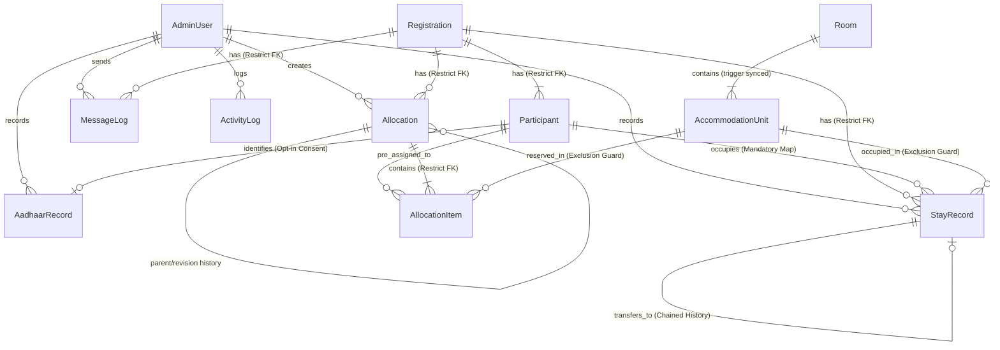

# Accommodation Management System - Database Design Specification (Hardened v2.1)

## 1. Architectural Overview & Single Source of Truth
The database architecture is designed using PostgreSQL and defined exclusively via Prisma Schema (`backend/prisma/schema.prisma`) as the single source of truth. Every database entity uses UUIDs for internal primary keys, human-readable identifiers for operational references, strict foreign keys with `onDelete: Restrict` to preserve auditability, soft-deletion/archival flags (`isArchived`, `deletedAt`), and PostgreSQL-level exclusion constraints to guarantee that double allocation or double physical occupancy is impossible at the database engine level.

---

## 2. Phase 2.1 Database Hardening Matrix

| Hardening Focus | Prior State | Hardened State (v2.1) | Enforcement Layer |
|---|---|---|---|
| **Allocation Conflict Protection** | Application-level interval check | PostgreSQL `EXCLUDE USING gist` constraint `[entryDate, exitDate)` | PostgreSQL Engine (`btree_gist`) |
| **Participant Gender** | Forced `MALE` default | Nullable `gender Gender?` (No default; unknown until reception) | Prisma & PostgreSQL |
| **Inventory Capacity Drift** | Manual room totals | Automatic PostgreSQL trigger `trigger_sync_room_capacity` | PostgreSQL Trigger |
| **Historical Records** | Destructive cascade delete | `onDelete: Restrict` + `isArchived`, `deletedAt` soft-delete | Prisma & Foreign Keys |
| **Participant-to-Unit Mapping** | Optional participant/unit link | Mandatory `participantId` & `unitId` on `StayRecord` | Schema Constraint |
| **Double Occupancy Protection** | Unconstrained stay overlap | PostgreSQL `EXCLUDE USING gist` constraint `no_overlapping_active_stays` | PostgreSQL Engine (`btree_gist`) |
| **Transfer History** | Overwrite stay | Chained `previousStayRecordId` + `transferReason` + `TRANSFERRED` status | Self-referencing FK |
| **Aadhaar Consent** | Default `true` | Explicit opt-in default `false` (`retentionConsent`) | Schema Constraint |

---

## 3. Legal & Compliance Notice: Aadhaar Data Collection

> [!CAUTION]
> **Statutory & Legal Compliance Notice Regarding Aadhaar Handling**
> Full Aadhaar number collection and storage is subject to the **Aadhaar (Targeted Delivery of Financial and Other Subsidies, Benefits and Services) Act, 2016**, the **Information Technology Act, 2000**, and the **Digital Personal Data Protection (DPDP) Act, 2023**. 
> 
> In this system:
> 1. Full 12-digit Aadhaar collection is implemented for physical reception desk verification only under explicit organizational authorization and participant opt-in consent (`retentionConsent` defaults to `false`).
> 2. **Plaintext Aadhaar is NEVER stored in the database.**
> 3. All Aadhaar numbers are encrypted at the application level using **AES-256-GCM** before persistence.
> 4. Only the `lastFourDigits` are stored in plaintext for masked display (`XXXX-XXXX-1234`) and fast administrative search.
> 5. **No external UIDAI or OTP integrations are implemented.**
> 6. Aadhaar numbers are strictly excluded from WhatsApp notifications, ordinary data exports, URL query parameters, and general application log files.
> 7. Configurable retention and soft-deletion controls (`deletedAt`) are implemented to comply with data minimization and right-to-erasure directives.

---

## 4. Entity Relationship Diagram



---

## 5. PostgreSQL-Level Hardening Specifications

### 5.1. Allocation Conflict Exclusion Constraint
```sql
ALTER TABLE "allocation_items" 
ADD CONSTRAINT "no_overlapping_active_allocations" 
EXCLUDE USING gist (
  "unitId" WITH =,
  tsrange("entryDate", "exitDate", '[)') WITH &&
)
WHERE ("status" IN ('TENTATIVE', 'CONFIRMED'));
```
- **Interval Semantics**: `[entryDate, exitDate)` where entry date is inclusive and exit date is exclusive. A participant departing on Nov 5 allows another participant arriving on Nov 5 to reserve the same unit without conflict.
- **Status Filter**: `CANCELLED` and `COMPLETED` allocations are excluded from conflict evaluation, making the unit immediately reusable.
- **Kernel-Level Enforcement**: Concurrent allocation attempts race at the database engine level; PostgreSQL raises error code `23P01` (`exclusion_violation`) against competing requests.

### 5.2. Active Stay Overlap Exclusion Constraint
```sql
ALTER TABLE "stay_records"
ADD CONSTRAINT "no_overlapping_active_stays"
EXCLUDE USING gist (
  "unitId" WITH =,
  tsrange("actualCheckIn", COALESCE("actualCheckOut", 'infinity'::timestamp), '[)') WITH &&
)
WHERE ("status" IN ('CHECKED_IN', 'EXTENDED'));
```
- Guarantees that no physical unit can have multiple active occupants simultaneously.
- When an occupant checks out or transfers, `actualCheckOut` is set and status updated to `CHECKED_OUT` or `TRANSFERRED`, releasing the unit.

### 5.3. Inventory Synchronization Trigger
```sql
CREATE OR REPLACE FUNCTION sync_room_capacity()
RETURNS TRIGGER AS $$
DECLARE
  target_room_id TEXT;
BEGIN
  IF TG_OP = 'DELETE' THEN
    target_room_id := OLD."roomId";
  ELSE
    target_room_id := NEW."roomId";
  END IF;

  UPDATE "rooms"
  SET 
    "totalBeds" = (
      SELECT COUNT(*) FROM "accommodation_units" 
      WHERE "roomId" = target_room_id AND "type" = 'BED' AND "status" != 'INACTIVE'
    ),
    "totalMats" = (
      SELECT COUNT(*) FROM "accommodation_units" 
      WHERE "roomId" = target_room_id AND "type" = 'MAT' AND "status" != 'INACTIVE'
    ),
    "updatedAt" = CURRENT_TIMESTAMP
  WHERE "id" = target_room_id;

  RETURN NULL;
END;
$$ LANGUAGE plpgsql;

CREATE TRIGGER trigger_sync_room_capacity
AFTER INSERT OR UPDATE OR DELETE ON "accommodation_units"
FOR EACH ROW EXECUTE FUNCTION sync_room_capacity();
```
- `AccommodationUnit` records are the sole source of truth.
- `rooms.totalBeds` and `rooms.totalMats` automatically stay in 100% mathematical sync with zero capacity drift.

---

## 6. Model Field Specifications (v2.1)

### 6.1. Registration (`registrations`)
- `id`: UUID (PK)
- `registrationId`: Unique readable identifier (`REG-0001`)
- `primaryName`: Contact person
- `mobile`: Mobile number
- `totalMembers`: Total registered group size
- `status`: `REGISTERED`, `ALLOCATED`, `CONFIRMED`, `CHECKED_IN`, `CHECKED_OUT`, `CANCELLED`
- `isArchived`: Boolean (`default: false`) - Soft-delete/archival flag
- `deletedAt`: Timestamp - Soft-delete timestamp
- *Foreign Keys*: `participants`, `allocations`, `stayRecords`, `messageLogs` configured with `onDelete: Restrict` to prevent accidental loss of operational history.

### 6.2. Participant (`participants`)
- `id`: UUID (PK)
- `registrationId`: FK -> `Registration.id` (Restrict)
- `fullName`: Actual individual participant name
- `gender`: Nullable `Gender?` (Values: `MALE`, `FEMALE`, `OTHER`, `UNKNOWN`, `null`) - **No forced MALE default**
- `age`: Int?
- `relationToPrimary`: String?
- `isPrimary`: Boolean
- `checkInStatus`: `REGISTERED`, `CONFIRMED`, `CHECKED_IN`, `CHECKED_OUT`, `NO_SHOW`, `CANCELLED`
- `isArchived`: Boolean (`default: false`)
- `deletedAt`: Timestamp?

### 6.3. Stay Record (`stay_records`)
- `id`: UUID (PK)
- `registrationId`: FK -> `Registration.id` (Restrict)
- `participantId`: FK -> `Participant.id` (Restrict, **Mandatory**)
- `unitId`: FK -> `AccommodationUnit.id` (Restrict, **Mandatory**)
- `allocationItemId`: FK -> `AllocationItem.id` (SetNull, Optional)
- `actualCheckIn`: DateTime (`default: now()`)
- `actualCheckOut`: DateTime?
- `status`: `CHECKED_IN`, `CHECKED_OUT`, `EXTENDED`, `EARLY_DEPARTURE`, `TRANSFERRED`
- `previousStayRecordId`: FK -> `StayRecord.id` (Self-relation for room transfers)
- `transferReason`: String?
- `recordedById`: FK -> `AdminUser.id` (Restrict)

### 6.4. Aadhaar Record (`aadhaar_records`)
- `id`: UUID (PK)
- `participantId`: FK -> `Participant.id` (Restrict, Unique)
- `encryptedAadhaar`: AES-256-GCM ciphertext
- `aadhaarIv`: Hex IV
- `aadhaarAuthTag`: Hex auth tag
- `lastFourDigits`: Plaintext 4 digits for masked display (`XXXX-XXXX-1234`)
- `complianceStatus`: `COLLECTED`, `VERIFIED`, `EXEMPTED`, `DELETED`
- `retentionConsent`: Boolean (**default: false**, explicit opt-in required)
- `recordedById`: FK -> `AdminUser.id` (Restrict)
- `deletedAt`: Timestamp? for compliance erasure
